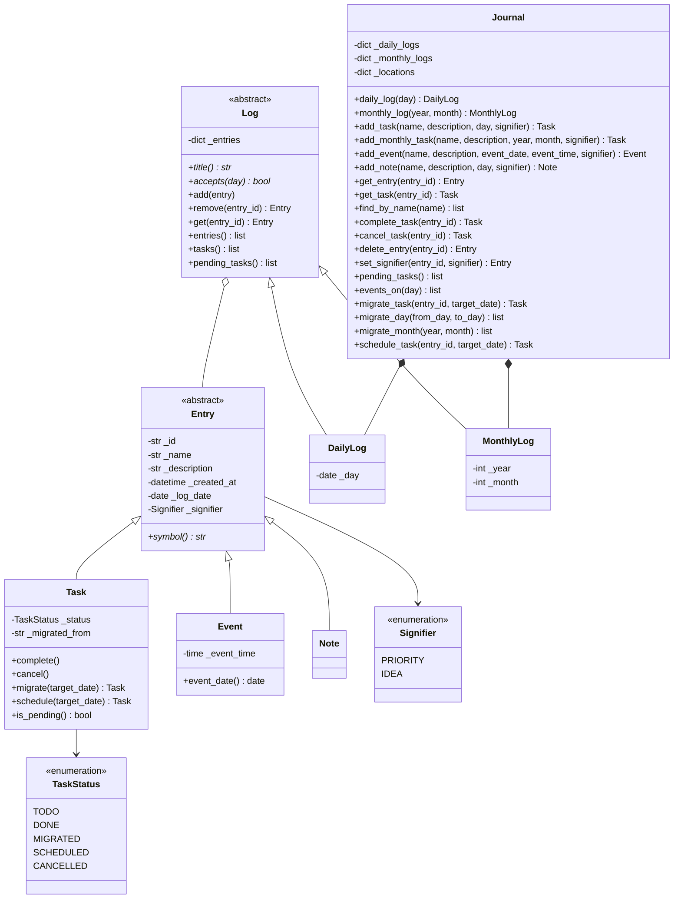
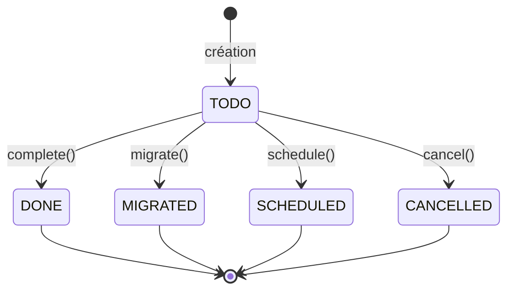

# Conception de la bibliothèque bujo

Ce document décrit le modèle objet de la bibliothèque et les choix de
conception de l'équipe.

## Diagramme de classes



Le Future Log, les collections et l'index seront ajoutés au niveau 3.

## Cycle de vie d'une tâche



Seule une tâche à faire peut changer d'état : les quatre autres états
sont définitifs. Toute autre transition lève `InvalidTransitionError`.

## Exceptions

```text
BujoError
├── EntryNotFoundError        identifiant inconnu
├── DuplicateEntryError       entrée ajoutée deux fois dans un log
├── ValidationError           donnée invalide
│   ├── EmptyNameError        nom vide
│   └── InvalidDateError      date ou heure invalide ou incohérente
└── InvalidTransitionError    changement d'état interdit
```

## Choix de conception

1. **Identifiant unique.** Chaque entrée reçoit un identifiant généré
   avec `uuid4`. Toutes les opérations utilisent cet identifiant ; la
   recherche par nom n'est qu'une facilité, car deux entrées peuvent
   porter le même nom.
2. **Encapsulation.** Les attributs sont privés et lus par des
   propriétés. L'état d'une tâche n'a pas de setter : il ne change que
   par `complete`, `cancel`, `migrate` et `schedule`, qui vérifient
   les règles du cycle de vie.
3. **Migration.** Comme sur papier, la tâche d'origine reste dans son
   log avec l'état « migrée ». Une copie à faire, avec un nouvel
   identifiant, est créée dans le log cible ; son attribut
   `migrated_from` contient l'identifiant de l'originale. Un nouvel
   identifiant est nécessaire car une entrée appartient à un seul log.
4. **Migration de fin de mois.** Toutes les tâches à faire du mois
   (Monthly Log et Daily Logs du mois) sont reportées dans le Monthly
   Log du mois suivant.
5. **Planification.** Une tâche planifiée est copiée dans le Monthly
   Log du mois visé (au niveau 3, elle ira dans le Future Log).
6. **Façade.** La classe `Journal` est le point d'entrée unique. Elle
   mémorise dans `_locations` le log de chaque entrée, ce qui permet de
   retrouver une entrée immédiatement.
7. **Séparation des responsabilités.** Le modèle (`entries`, `logs`,
   `journal`) ne sait pas comment il est affiché (`display`). La
   validation des saisies est regroupée dans `validation`.
8. **Dates.** Les dates sont des objets `date` du module `datetime`,
   jamais des chaînes. Les objets `datetime` sont refusés, car Python
   ne sait pas les comparer avec des `date`.